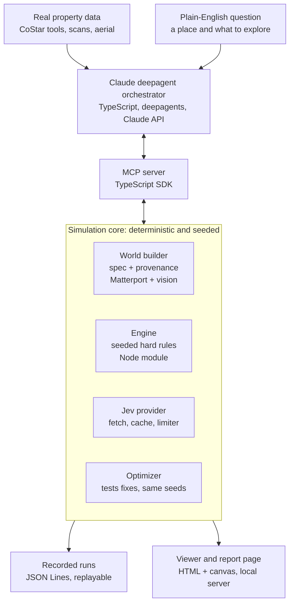

# Swarmscope: Project Spec (Source of Truth)

> **Version:** v0.33 · Nov 14, 2026 · HackPrinceton Fall 2026
> **Direction (Nov 14, v0.27):** Swarmscope is a **general environment simulation engine**. Users define an environment, objectives and guidelines; headless Claude builds a validated declarative environment; individual Jev agents choose actions while the engine enforces state transitions, shared resource capacities and conditions. Independent businesses and physical crowds remain examples, rather than the product boundary. The legacy physical engine remains governed by [docs/PROTOTYPE.md](docs/PROTOTYPE.md); the new workflow contract lives in `generalist/schema.json` and `docs/GENERALIST.md`.
> **Worked example (v0.24):** the first audience is **independent local businesses**, starting with counter-service food and drink. Owners can test a change on a simulated copy of their own customers before trying it on real ones. The use case is specified in [INDEPENDENT_BUSINESS_SPEC.md](INDEPENDENT_BUSINESS_SPEC.md). Everything below still describes the engine and the earlier building work, and [docs/PROTOTYPE.md](docs/PROTOTYPE.md) still governs the code.
> **Page copy of this spec:** the "Swarmscope (Copy)" artifact, v0.13 (https://claude.ai/artifact/8hjEXehseEmDftQL2wscnx). It is a copy of the spec, not the prototype.
> **Original prototype:** the "Swarmscope" artifact (https://claude.ai/artifact/Mc6u5T29E7aKWGyBgeZmCW), which holds the v0.1 engine and viewer.
> **Origin:** the team doc "Swarmscope: Every Agent a Jev Agent" (Nov 13, 2026)
> **Build contract for the code:** [docs/PROTOTYPE.md](docs/PROTOTYPE.md) (module interfaces, decision protocol, file formats)
>
> This is the ground-truth context document for the project. Humans and coding agents should read it before changing code. **Rule: change this file first, then the code, and log every decision in the change log (section 14).**
>
> **Never commit secrets or raw hackathon data to this repo.** That means API keys, `.env*` files, the hackathon keys zip, and raw CoStar, Matterport or Vexcel dumps. Hackathon data is only available during the event. Keep `.env`, `.env.*` (except `.env.example`), `*.zip`, `keys/`, `data/`, `runs/` and `node_modules/` in `.gitignore`.

**Status tags used below:** `[built]` exists in the prototype · `[planned]` decided, not built · `[candidate]` possible, not decided · `[open]` unresolved or unverified · `[confirmed]` verified by a test.

---

## 1. What we are building

**Define the environment. Claude or Codex builds it. Jev agents make the decisions.**

Swarmscope accepts a user's environment, objectives, guidelines and constraints. Headless Claude builds a validated declarative workflow: roles, actor goals, shared state, resource capacities, timed actions and metrics. **Jev**, TypeSafe's structured-decision model, chooses an action for each actor; deterministic code enforces eligibility, capacity and state changes. Definitions and decision traces remain inspectable. This general engine supports bounded operational workflows such as incident response and fulfillment; it does not execute arbitrary generated code. The earlier physical engine still answers questions such as "which ER gets overwhelmed on a Friday night?" using places, queues, routes and people. Historical physical-engine plans, including the optimizer, remain below.

### Decisions to date

- **Codex builder (Nov 14, v0.30):** add `codex` alongside the existing Claude Code and Anthropic builders in Scope, the API and CLI. Use installed, authenticated `codex exec` in a temporary working directory with explicit read-only permissions, user configuration ignored, command execution and integrations disabled, bounded output and cancellation. Both builders return the same validated environment contract and use the same Jev runtime and replay format. Keep Claude Code as the default; preserve builder provenance and give provider-specific setup errors. Codex transport must accommodate its structured-output restrictions without weakening runtime validation.

- **Scope continuity (Nov 14, v0.28):** general environments reuse the existing Scope presentation: prompt bar, simulation canvas, right-hand metrics and incidents, playback timeline, theme, and a details drawer. The separate card-based Studio presentation is superseded. Logical workflow positions are labeled as such rather than invented physical geometry. Custom environments and original spatial cases share the product's visual format. Headless generation uses the explicit `claude -p` invocation. Server health advertises environment capabilities so a stale process produces a useful restart instruction instead of missing-endpoint errors.

- **Generalist direction (Nov 14, v0.27):** supersedes the v0.24 audience restriction. Add a separate versioned workflow environment contract and runtime alongside physical visit/route worlds. Environment definitions contain roles, scalar world and actor state, actions, durations, resource reservations, conditions, effects and metrics. User guidelines are behavioral context; hard constraints must be represented as executable declarative conditions and resource limits. Generated JavaScript is never executed. Headless Claude Code runs without tools in an isolated working directory, with bounded output, time and repair attempts; an Anthropic API backend is also available. Persist the brief, definition, assumptions, build metadata and per-agent decision traces. A Studio provides build, inspect, edit, run and replay; a rules provider makes this flow usable offline. Results remain exploratory, not forecasts. Existing demos and physical runs remain available.

- **Jev per agent is committed.** The Jev-vs-rules comparison is dropped. Rules remain only as an API-outage fallback and as the optimizer's fast proxy.
- **Tracks** (superseded by v0.24, see below). CoStar is the headline. LangChain Deep Agents and Amazon are stackable targets. **Peri is dropped at Saturday midday** unless a real business has already shared its numbers by then.
- **CoStar engineers (Nov 13):** build the Jev simulation from CoStar data first, then generalize the central agent to a wider range of cases. Add visualization of the simulation over time (a time scrubber). The central agent can assign x% of the Jev agents to a specific role (specific roles are undecided).
- **Emphasis (Nov 13):** the two simulations built from CoStar data are **building congestion** (movement inside a building, from Matterport geometry) and the **retail store parking lot** (Vexcel imagery plus CoStar data).

- **Focus (Nov 14, v0.16):** simulate foot traffic through one real building first: Matterport model `6FNMVoyPrL1` ("Office/Retail - 45,726SF"), using its interior walls and doorways and the building's CoStar data. Everything else waits for this.
- **Direction (Nov 14, v0.24):** the product now targets independent local businesses that cannot afford consultants and avoid changes (prices, menu, hours, staffing, layout) for fear of losing customers. Counter-service food and drink comes first. Peri becomes the primary track, and the CoStar submission is undecided. The building work above stays in the repo as a capability (walls, doors, objects, replay). Details are in [INDEPENDENT_BUSINESS_SPEC.md](INDEPENDENT_BUSINESS_SPEC.md).

### Status of the prototype

The original prototype (the "Swarmscope" artifact, v0.1) has a **Minds** switch. With minds off, agents follow archetype-level rule-based stochastic policies. With minds on, Claude role-plays up to 40 personas (about 15 in the examples), batching up to 20 per call, and each persona's decision steers its whole crowd. Claude also compiles the world, analyzes results and interviews agents. The team doc's description ("about 15 personas that each steer a crowd") matches minds-on mode.

**v0.2 (Nov 14):** the first Jev-per-agent prototype is being built in this repo per [docs/PROTOTYPE.md](docs/PROTOTYPE.md): the engine extracted as a Node module, one Jev request per agent decision, a rules provider, run recording and replay, a local viewer with a time scrubber, a world compiler, a Claude Code slash command, and an MCP server. Claude cohort minds are removed; Claude no longer decides for agents.

---

## 1b. The CoStar demo question

> **Earlier focus (before v0.24).** This section describes the CoStar building demo. The current product is the independent-business use case in [INDEPENDENT_BUSINESS_SPEC.md](INDEPENDENT_BUSINESS_SPEC.md). Whether we still submit this demo to CoStar is `[open]` (section 10).

`[planned]` The demo answers one question about one real retail property:

> **"Where does this center lose shoppers on a busy Saturday, and what is the cheapest fix?"**

1. **Build the world** from CoStar data and Vexcel aerial imagery: lots, entrances, spaces held from arrival to exit, walking distances, stores and checkout lines, and a Saturday-afternoon arrival pattern. Every parameter is tagged by provenance.
2. **Run the swarm.** Jev agents decide whether to park, join, wait, divert or leave. The bottleneck score (wait minutes + 30 × people who abandon) ranks where shoppers are lost.
3. **Optimize.** The optimizer tries changes within bounds and costs, for example redirecting traffic to a second lot, adding a checkout lane, or staggering staff parking. Each candidate re-runs on the same seeds.
4. **Report.** Claude writes a one-page recommendation for a broker, with the gain measured on held-out seeds and assumed parameters flagged.

### Two simulations from CoStar data (emphasis, Nov 13)

`[planned]`

1. **Building congestion:** how people move through a building's interior, using Matterport room outlines and doorways. Doors, corridors, lobbies and elevators are the likely bottlenecks.
2. **Retail store parking lot:** cars and shoppers at a retail property, using Vexcel imagery for the lot and space count and CoStar data for the property. The entrance, the search for a space and the walk to the store are the likely bottlenecks.

The four steps above apply to both. Ideally both come from the same property, so the demo shows the inside and the outside of one address.

> The levers are illustrative. Each needs engine support before it can be tested: a second lot and staff parking depend on held resources and `geo`, and a checkout lane is a capacity change. The result is a ranking of fixes under our assumptions, not a forecast.

---

## 2. Claims

### 2a. What we claim

- Agents that decide individually, see only what a real person would see, and influence each other produce herding, rumor cascades, loyalty and giving up, which formula-based models do not.
- Ranked bottlenecks and fixes that hold across many plausible versions of the crowd (20 seeds, made-up inputs nudged ±25%).
- Worlds compiled from real property data and aerial imagery, with every parameter tagged by where it came from.

### 2b. What we do not claim

- That simulated agents behave like real people. That is unvalidated, and we say so.
- Exact waits or forecasts. We claim rankings, not numbers like "the wait will be 85 minutes."
- That TypeSafe's speed, cost and calibration figures hold. They stay unverified until we measure them.

### 2c. Lineage

This builds on the premise behind Physical Realities (MHacks 2026 Grand Prize): a model predicts each agent's choice from what it can observe, and a deterministic engine samples and executes it. That team called their tool an exploration aid, not a validated predictor. We add a social layer, a domain-general world spec, optimization of fixes, and a validation plan.

---

## 3. Project guidelines

1. **Words at the edges, decisions in the middle.** Claude turns the question into a world and a cast, and results into findings. Jev makes each agent's typed decision. The engine enforces every hard rule (money, capacity, hours).
2. **Sample, don't take the top answer.** Draw each action from Jev's probabilities, so similar people differ.
3. **Ask small typed questions and combine them in code** (Choice, Score, Noul).
4. **Agents see only what a real person would:** live waits only with an app, nearby lines otherwise, recent remarks from plausible sources, and place reputations Claude wrote.
5. **Models choose among options the engine says are valid.** They never change the world directly. Walls are one of those hard rules: the engine moves every agent along wall-free paths, so no agent passes through a wall.
6. **Seeded and reproducible.** Save the spec hash and seed with every run. Before/after tests reuse the same seed and arrivals.
7. **Rankings, not forecasts.** Check every headline claim on 20 seeds and with inputs nudged ±25%. The optimizer reports gains on held-out seeds.
8. **Record every decision** (state, probabilities, sampled action). The demo replays recorded runs and never depends on live latency.
9. **Fall back to rules only if the Jev API is down,** and label which provider made each decision. Report the fallback rate; a run with heavy fallback does not count as a Jev run.
10. **Vendor figures stay marked unverified** (speed, cost, calibration, rate limits) until we measure them.
11. **Every parameter carries provenance** (data, vision-estimated, assumed, or owner-reported). Assumed values stay adjustable and are part of the robustness check.
12. **Spec first.** Change this file, then the code, and log the decision in section 14.

---

## 4. Architecture

```
SURFACES               ORCHESTRATOR (Claude)               CORE (deterministic, seeded)
Web viewer   ─┐        compile: sentence → spec            validate_world(spec)
Report page   ─┼─tools─ analyze: metrics → findings   ───►  run_swarm(spec, seeds)
Claude Code  ─┘        propose: levers, bounds, cost         optimize(spec, levers, budget)
                       critique: robustness, blind spots   compare(spec, patch)
                                                           agent_log(spec, seed, id)
                  World builder: CoStar + Vexcel + owner data → spec with provenance
                  Jev provider: per-agent state + typed questions → sampled action
          STORE + EVALS: specs, seed + spec hash, decisions, replays, test suite
```

### Components

| Component | Job | Status |
|---|---|---|
| Claude | Builds world and cast from the prompt; writes analysis, quotes, agent interviews | `[built]` in-page, with rule-based agents |
| Engine | Seeded simulation: arrivals, queues, roads, metrics. To add: held resources (parking), a `geo` scale, per-agent random streams | `[built]` in the prototype; `[planned]` extraction as a Node module (no TypeScript port this weekend) |
| Jev decision provider | Builds each agent's state and typed questions, keeps requests in flight, samples answers, caches probabilities by state, falls back to rules only if the API is down | `[planned]` (committed) |
| Run recorder | Saves every decision so a run replays with no API calls | `[planned]` |
| Viewer | Map, rankings, charts; add each agent's Jev probabilities on hover and a time scrubber that replays the simulation over time | `[built]` map and charts; `[planned]` probability view and time replay |
| Scope display | Case-specific display for the two CoStar simulations at `web/scope/`: real floor plan or lot, incident heat that builds over time, a slider with an incident histogram and key moments, a prompt matched to the two cases, an agent inspector, and the Matterport 3D tour on click. Runs on mock data until linked to recorded runs (contract: [docs/PROTOTYPE.md](docs/PROTOTYPE.md) §9b) | `[planned]` |
| Optimizer | Searches fixes under a budget (section 8) | `[planned]` |
| MCP server | `validate_world`, `run_swarm`, `compare`, `optimize`, `agent_log`, `open_viewer` | `[planned]` |
| Eval suite | Validation tests and spec-compile accuracy (section 7) | `[planned]` |
| World builder | Turns CoStar data, Vexcel aerial imagery, Matterport geometry and owner numbers into a world spec, tagging every parameter by provenance (data, vision, assumed, owner-reported) | `[planned]` |
| Deepagent orchestrator | Plans the run and calls CoStar's MCP tools and ours, with subagents for data gathering, world building and analysis | `[planned]` |
| Calibrate (Peri) | Fits arrivals, service times and patience to a business owner's numbers, holds out one hour as a test, shows the fit | `[candidate]` dropped at Saturday midday unless a business has shared numbers |
| Report page | One-page plain-language recommendation for a broker or business owner | `[planned]` |

> The Jev version runs as a small local server plus a viewer, because a claude.ai artifact cannot call outside APIs. The artifact can still replay recorded runs.

### 4b. Diagram



### Proposed tech stack

This is a proposal, not a commitment. The two `[open]` rows depend on what the Jev API and the CoStar workshop turn out to provide.

| Layer | Choice | Notes | Status |
|---|---|---|---|
| Language and runtime | TypeScript on Node for the orchestrator and MCP server. The engine stays JavaScript, extracted from the prototype. | One runtime, so the orchestrator calls the engine directly and a small team shares code. Use Python only if CoStar's SDK requires it. | `[planned]` |
| Orchestrator | deepagents (TypeScript, on LangGraph) with Claude through the Anthropic API | Provides planning, subagents and a file workspace. Tools are our MCP server plus CoStar's MCP tools. LangChain publishes an official TypeScript package. | `[planned]` |
| Tool interface | MCP server built with the official TypeScript SDK (`@modelcontextprotocol/sdk`) | Exposes `validate_world`, `run_swarm`, `compare`, `optimize`, `agent_log`, `open_viewer`. | `[planned]` |
| Engine and tests | JavaScript module with a seeded random stream per agent. Vitest for the Erlang C and Braess tests. | Extracted from the prototype's engine. No TypeScript port this weekend. | `[planned]` |
| Jev provider | Node `fetch` with a concurrency limiter and a cache keyed by agent state | The API's request format, limits and latency are unconfirmed. Measure in hour one. | `[open]` |
| World builder | Node. CoStar data through its MCP tools, room geometry through the Matterport Model API (GraphQL), Claude vision for aerial imagery and anything the geometry lacks. Output is a spec with provenance. | Keys are self-generated per the organizers. Unconfirmed: CoStar's SDK language and the Vexcel format. | `[open]` |
| Storage | JSON Lines files for decisions and recorded runs. No database. | A run replays from its file with no API calls. | `[planned]` |
| Viewer and report | Plain HTML and canvas, served by a small local Node server | The artifact can replay recorded runs but cannot call outside APIs. | `[planned]` |

---

## 5. Agent design and social layer

Every agent carries a persona from Claude's cast plus its own state: where it is, what it has done, how long it has waited, what it can see and what it has heard. At each decision moment the simulator sends that state to Jev with a few typed questions, then samples the action from Jev's probabilities.

| Decision moment | Question to Jev | Type |
|---|---|---|
| Arrives, or finishes somewhere | Where does this person go next? (each place, plus "leave") | Choice |
| Reaches a long line | Do they join it? | Noul |
| Has waited past their patience | Do they keep waiting? | Noul |
| Starts a trip | Which of these routes do they take? | Choice |
| Any decision | How frustrated are they now? (calm to furious) | Score |
| Any decision | Would they warn others about this place? | Noul |

**Social layer without text.** Jev cannot write a rumor, but it can decide whether one happens. When an agent's "warn others" answer is yes, the simulator posts a structured remark: who said it, where, and what kind (long line, bad service, good experience). Later agents see recent remarks in their state. Frustration lowers patience. Afterward Claude turns the structured remarks into readable quotes for the thought stream and report.

**Roles.** `[planned]` The central agent can designate a share (x%) of the Jev agents to take a specific role, so the simulated crowd better matches the real place. The role and its share are part of the world spec and are tagged by provenance like any other parameter. Which roles improve the simulation most is still to be decided and tested.

**Emergence, in short.** World rules and the available options are hard-coded. Outcomes are not scripted. Emergent effects need many agents, shared state, and feedback between them. An ablation with the social layer switched off shows which effects come from interaction.

---

## 6. World spec (contract between Claude and the engine)

```
title, question, mode: "visit" | "route", duration, clockStart, travelSpeed (visit)
arrivals: { total, start, end, shape: uniform | peak | early | late }
nodes[]   visit: gate | entry | exit | service (servers, serviceTime, appeal, price, tags)
          route: origin | destination | intersection
edges[]   route only: from, to, name, length, capacity, twoWay
archetypes[]  share, description, info, rationality
          visit: weights{appeal, wait, distance, price}, visits, patience, likes, needs
          route: origins, destinations
patchable (what-ifs): node servers | serviceTime | appeal | price
          edge capacity | length | closed; archetype info | patience | rationality | visits | share
          global arrivals.total | start | end, travelSpeed

# planned additions
cast[]        per-person personas Claude writes (situation, constraints such as insurance, loyalties)
reputation    text on each place that agents can see
remarks       structured social posts (who, where, kind)
optimize      { objective, budget, levers[] } (section 8)
geo           { metersPerUnit, source image } so walking times are real
held[]        resources an agent holds from arrival to exit (parking spaces)
provenance    per parameter: data | vision | assumed | owner-reported
roles[]       { role, sharePercent, behavior } assigned by the central agent
walls[]       { x1, y1, x2, y2 } wall segments in map units; doors and openings are gaps (v0.15)
edges[].via   route mode: waypoints so an edge bends through a doorway (v0.15)
```

The validator rejects bad specs with readable errors, so Claude can fix its own output. Claude decides what the agents are, and the user reviews the proposed agent list before anything runs.

**Bottleneck score.** Visit mode: wait minutes + 30 × abandoned. Route mode: delay minutes.

---

## 7. Validation plan

| Check | What it shows | Status |
|---|---|---|
| Erlang C | One line, random arrivals: engine waits match the textbook queueing formula. Example: M/M/1 with λ=0.8, μ=1 gives Wq = 4 min. Needs Poisson arrivals and no abandonment. | `[planned]` |
| Braess's paradox | Route mode: adding a shortcut makes trips slower when drivers have live info. Example: 4000 drivers, T/100 and 45 min legs: 65 min without the shortcut, 80 with it. | `[planned]` |
| Known effects | Reproduced without being told: app-routed drivers jam a shortcut, herding toward famous rides, walk-aways as waits grow | `[planned]` |
| Robustness | 20 seeds, and patience, crowd size and app use nudged ±25%. Conclusions must survive. | `[planned]` |
| Jev sanity checks | Behavioral unit tests on the model: the probability of joining a line falls as the wait grows, and unavailable options are never chosen | `[planned]` |
| Calibration to owner numbers | Fit to a real business's arrivals and service times, then test on a held-out hour | `[candidate]` (Peri) |
| Spec-compile accuracy | Eval set of sentence → spec cases: how often Claude's world is valid and sensible | `[candidate]` |
| Sioux Falls benchmark | Route mode vs published equilibrium flows (24 nodes, 76 links). Needs unit conversion and demand scaling, so approximate. | `[candidate]` |

None of these is field data. They validate the engine against known answers, not agents against real people.

---

## 8. Optimizer (design)

- Claude writes an `optimize` block: objective, budget, and levers with bounds and costs. The validator clamps it to the patchable fields.
- Greedy search by gain per cost. Every candidate runs on the same seeds (common random numbers), which keeps comparisons fair.
- Stop when the best gain is within noise (about 2× the standard error).
- Report the final gain on held-out seeds the search never saw, then rerun with demand and info shifted. Claude states what the design ignores.
- `[planned]` Search with a fast proxy first (the rule-based policies in the prototype), then confirm the top few candidates with Jev runs, because a proxy optimum may not be Jev's optimum. Jev runs cost money and time.

---

## 9. Scale and cost estimates `[open]` unverified

From the team doc, using TypeSafe's published price of $0.042 per million input tokens (output free) and 70–500 ms per call. Assumes about 1,500 input tokens per request, all of a decision's questions in one request, and 50 requests in flight at about 300 ms each. **We have not measured any of this.**

| World | Agents | Jev requests | Input tokens | Cost | Wall time |
|---|---|---|---|---|---|
| Theme park day | 2,600 | ~21,000 | ~31M | ~$1.30 | ~2 min |
| Rush-hour roads | 3,600 | ~5,000 | ~7.5M | ~$0.32 | ~30 s |
| Friday night ER | 560 | ~1,100 | ~1.7M | ~$0.07 | ~7 s |

Two assumptions to verify first:

1. **Roads:** ~5,000 requests for 3,600 agents implies one route choice per trip, but the current engine chooses at every intersection. Per-intersection calls would multiply requests several times. **v0.2 decision:** Jev picks one route per trip from up to 3 options; links along the way use the rule-based logit.
2. ~~TypeSafe's docs recommend one well-scoped question at a time.~~ **Resolved (Nov 14):** the docs say there is no limit on questions per request (only the 64k per-request and 32k per-question context limits) and recommend packing related questions into one request. Each decision is one request with all its questions.

**Measured once (Nov 14, `jev-latest` = `jev-1.14.0`, from the hackathon network):** about 100–250 ms per request (p50 100–155 ms, p95 135–250 ms). A realistic agent decision with 4 questions used 914 input tokens; a one-question request used 325. 8, 32 and 64 parallel requests all returned 200 with no rate limiting. Org rate limits are listed in the TypeSafe console. One measurement is not a benchmark; recheck before the demo.

Thousands of agents per run is realistic. Millions is not.

---

## 10. Tracks and integrations

**Decision (Nov 14, v0.24), replacing the one below:** Peri is the primary track, with the independent-business product ([INDEPENDENT_BUSINESS_SPEC.md](INDEPENDENT_BUSINESS_SPEC.md), sections 11 and 12). The CoStar submission is `[open]`: undecided, and the building demo stays in the repo. Amazon and LangChain are unchanged.

**Decision (Nov 13), superseded by v0.24:** CoStar is the headline demo. A Peri business is a time-boxed second world and calibration case, **dropped at Saturday midday** unless a real business or student org has already shared its numbers.

### CoStar: "Inside and Out: AI for the Built World"

- **Rewards:** 30% use of the data (at least two of CoStar building data, Matterport 3D scans, Vexcel aerial imagery), 30% agentic depth, 25% usefulness, 15% demo. Wants spatial and visual understanding, not a chat wrapper.
- **Organizer brief:** use at least two of the three layers and get something out of the combination; be agentic (reason, plan, act); solve a real problem for a real person, in real estate or elsewhere. They want projects that make them say "we didn't know you could do that with our data."
- **Prize:** $1,500 / $500 / $250 cash. Finalists get fast-track interviews with CoStar's AI team. Winning projects get a roadmap review. Stacks with any other prize.
- **Upside:** fits the simulator plus agent loop. Real Houston and LA data (8.5 million commercial properties with leases, sales, tenants and available space), with engineers from all three companies on site and in the Discord. Vexcel imagery is sharp enough to count parking spaces from the air.
- **Risks:** data covers Houston and LA only. The toolkit provides SDKs, MCP servers and OpenAPI services, and keys are self-generated, so the learning curve is the tools, not access. Organizers say the three layers cover the same buildings, so overlap is expected; the open question is how many are retail with a parking lot. Service times and foot traffic are not in the data, so they are labeled assumptions. The simulation is unvalidated, so present it as a scenario explorer. Needs a real spatial and visual component, not only the 2D abstract map. Highest effort.

### Peri: Forward Deployed Challenge `[planned]` primary track (v0.24)

- **Rewards:** real-world need, usability (could the business adopt it immediately), end-to-end execution. Must name the business, the person consulted and their role, and give one piece of evidence. Student orgs and clubs qualify.
- **Prize:** top three get introductions to hiring teams at Cognition, Edra, Ephemeral, Sea12, Arca and Poetic, plus Peri's talent network. No cash listed.
- **Upside:** a real conversation gives real arrivals, service times and walk-away rates, our first real calibration, and a true customer story.
- **Risks:** a general simulation platform is a stretch for a small business to adopt immediately; the deliverable must be simple (for example a staffing or layout recommendation). Needs genuine consultation time. A local business does not match CoStar's Houston and LA data. Splits focus. One business is one data point.

### Other sponsors and integrations

| Sponsor | Idea | Status |
|---|---|---|
| LangChain | "Best use of deepagents" (Switch 2 for winners; build a deepagent for any use case). Judged on complexity of use case, effective use of Deep Agents (subagents, file system) and the demo. Build the orchestrator as a deepagent that calls CoStar's MCP tools and our Swarmscope tools, which also serves CoStar's agentic-depth criterion. | `[planned]` target |
| Amazon | "Best Practical AI Innovation" (gift cards, $125 / $75 / $50 per person, up to 4 team members each). Judged equally (25% each) on creativity, usefulness, technical implementation and user experience. Needs a working prototype, a clear use case and target user, basic documentation and a pitch. Favors AI that reasons, plans, takes multi-step actions and adapts from feedback, so show the optimizer learning from run results and the user's constraints. | `[planned]` target |
| Photon | Not in the special-tracks PDF. A chat front end (a judge texts a question and gets ranked bottlenecks) stays an idea only. | `[open]` no listed track |
| Mechanize, Scale | Not in the special-tracks PDF. A reset / step / reward wrapper stays a low-priority idea. | `[open]` no listed track |

- **Entry rules are unconfirmed.** The PDF says CoStar stacks with any other prize and Peri accepts a project from any track. Ask the organizers whether one submission can enter CoStar, Peri, LangChain and Amazon together.
- Only integrate where we genuinely use the tech. Arlequin (forensics, social-network analysis) and the Physical AI hack (hardware) do not fit. Jev and TypeSafe are not a listed track, so Jev is a design choice here, not a prize requirement.

---

## 10b. Data we will get, and candidate worlds `[open]`

### Data

Per the organizers: we generate our own Matterport API keys, and they supply a large library of Matterport spaces, Vexcel aerial data, and CoStar real estate data in Houston and Los Angeles. Matterport developer docs: https://matterport.github.io/developer-docs/overview/. Hackathon tooling: `/costar-keys` (self-generate keys) and `/ask-costar` (knowledge base) in the hackathon Discord.

Unconfirmed: which properties appear in more than one of the three sources, and the join key between CoStar properties and Matterport spaces or Vexcel regions.

### How interior data feeds the world builder

Matterport's Model API (GraphQL, `https://api.matterport.com/api/models/graph`, Basic auth with token ID and secret) returns room outlines, doorway openings and areas. Layout and distances come from measured geometry and are tagged `data`. A vision step covers what geometry does not give (counters, checkouts, seating), tagged `vision`. One building gets checked by a person before we trust the extraction.

### Where interior walls come from (Nov 14)

`[planned]` Matterport gives two sources, and the world builder uses both:

- **Vector data** (Property Intelligence, preferred). Each room boundary edge is typed `wall` (physical) or `invisible` (an open-plan divider people can cross), and lists its openings (`doorway` or `opening`) with a width and a position along the edge. Wall edges become wall segments with gaps at the openings. Matterport's docs say this data needs an Enterprise-level subscription and is only filled in for models processed after November 2023.
- **The mesh** (the model's OBJ 3D surface, fallback). Slicing it at about chest height gives wall lines. This is noisier: tall furniture can show up as a wall, so a person checks the result.

`[open]` The first tests (below) saw opening types `window` and `divider`, which Matterport's docs don't list. The builder treats any opening type other than `doorway` and `opening` as solid and warns. Confirm on real models.

`[open]` No Matterport keys are on the machine that built v0.2, so the importer is only tested against a hand-made fixture. Run it once against a real model.

### Findings from the first Matterport tests (Nov 13)

Two models were queried: a 1BR apartment and a 15,000 SF retail space.

- `[confirmed]` **Geometry comes back.** Floor vertices and edges, room outlines (with holes for columns), and openings with a type (doorway, opening, window, divider), a width and a position along the wall. The retail model returned only generic openings, no doorways.
- `[confirmed]` **Area estimates are populated.** The apartment reported 52.72 m² against 664 SF in its name, probably a wall-thickness or gross-area difference (unverified).
- `[open]` **Room labels are empty and classifications only work for homes.** The label set is residential. The retail model's rooms came back as "Other" or "Void", two large retail floors were tagged "staircase", and ceiling height was missing. What each space is (store, checkout, seating) must come from vision or from CoStar tenant data.
- `[open]` **The library is mostly apartments.** Of 14,944 models, only three look like retail: a 15,000 SF retail space, a street-level retail space, and a 45,726 SF office/retail space. Search matches fields beyond the name, so keyword counts overstate retail.
- `[planned]` **Key rooms by model ID plus room ID.** Room IDs repeat across models.
- `[planned]` **Building-congestion model: Office/Retail - 45,726SF (`6FNMVoyPrL1`).** Two floors, about 2,227 m², two large rooms per floor with holes for columns and obstacles, and 19 openings that are all typed `opening` (none `doorway`). Entrances are inferred from openings in exterior walls. Room labels are unreliable, so service points (checkout, reception, stairs) are placed by hand and tagged `assumed`.
- `[built]` **The mesh is a wall.** CoStar's indoor (Matterport) data includes a 3D mesh for each model (OBJ, 50k and 500k triangles, from `assets.meshes`). The room outlines miss shelves, counters and furniture; the mesh has them. **Jev agents must never walk through the mesh.** The backend treats any mesh surface between about 0.3 m and 1.5 m above the floor as impassable. In the engine, `swarm fitout --mesh` finds each solid object the mesh shows inside the rooms at that height (`builder/objects.js`), writes it to the world's `objects`, and the engine adds every object outline to the walls (v0.23; [docs/PROTOTYPE.md](docs/PROTOTYPE.md) §13f). The display's mock data uses the shared `geometry/obj-slice.js` grid instead.

### Candidate worlds

| World / use case | Question | Agents | Likely bottleneck | Levers | Engine needs | Status |
|---|---|---|---|---|---|---|
| **Building congestion (headline)** | Where do people get stuck moving through this building at peak times, and which change helps most? | Occupants and visitors choosing destinations and routes, and whether to wait or leave | Doorways, corridors, lobby, elevators | Stagger arrivals, open another entrance, move a service point, change which doors are used | Walkable graph from Matterport outlines and openings; door capacity from opening width; corridors and doors as capacity-limited edges, which may reuse route mode | `[planned]` |
| **Retail store parking lot (headline)** | Where does this center lose shoppers on a busy Saturday, and what is the cheapest fix? | Shoppers choosing where to park, which store, whether to wait | Parking near the best entrance, one checkout line | Second lot, extra checkout lane, staggered staff parking | Held resources, `geo` | `[planned]` |
| Food hall or restaurant lunch rush | Where do we lose diners at noon? | Diners choosing a stall, a line, or leaving when no table is free | Seating, or one popular stall | Seating mix, stall layout, ordering ahead | Held seats (same as retail) | `[candidate]` cheapest second world |
| Office space utilization | Is this floor plan right-sized, and where do people get stuck on a busy day? | Employees deciding whether to come in, which desk or room to take, and whether to give up | Meeting rooms, morning elevators, the lobby turnstile | Convert desks to rooms, stagger arrivals, elevator zoning | Held desks and rooms, elevators as batch service, multi-floor | `[candidate]` strongest tie to CoStar's customers and to interior scans |
| Building evacuation | Which exit jams, and do people herd toward the familiar one? | Occupants choosing an exit | The main exit | Signage, exit use, staging | Pedestrian movement in route mode | `[candidate]` lowest priority; exploration only, never a safety certification |

None of these is built yet. Office utilization uses the interior scans most directly and speaks to a broker's lease decision, so pursue it if time allows. The food hall is the cheapest second world.

---

## 11. Build order

1. **Hour one, in parallel:** measure Jev (access, latency, rate limits, questions per request, per-trip vs per-intersection choices) and confirm CoStar data access for one Houston or LA retail property.
2. **Extract the engine into a Node module** (no TypeScript port this weekend) and run the example worlds headless. Add per-agent random streams, tick semantics, and the Erlang C and Braess tests.
3. **Engine additions:** held resources (parking), the `geo` block, role assignment (a share of agents per role), and for building congestion doorway capacity from opening width and movement through a walkable graph.
4. **Jev decision provider:** typed questions per decision, sampled answers cached by state, rule-based fallback for outages only.
5. **Run recorder and replay,** so the demo never depends on live latency.
6. **World builder with provenance:** compile one real property from CoStar data, Matterport scans and Vexcel imagery into a spec, tagging each parameter data, vision, or assumed. Convert room outlines and wall openings into a walkable graph (door nodes, room centers, path lengths).
7. **Viewer:** hook it to recorded runs and add the probability view and a time scrubber to replay the run over time.
8. **Optimizer loop** with held-out seeds.
9. **MCP server and deepagent orchestrator:** the agent calls CoStar's MCP tools and ours to build, run, read, propose and compare.
10. **Peri, hard cutoff Saturday midday:** dropped at that point unless a real business or student org has already shared its numbers. If it has, add the calibrate step and an owner-facing report page.
11. **Generalize the central agent:** once the CoStar-based Jev simulation works end to end, adapt the orchestrator to build worlds for other cases (office, lobby, food hall, and the prototype's example worlds).
12. **Submission pack:** a short README, a one-line target user and use case (a broker or property owner), and the pitch, so the Amazon requirements are met.
13. **Stretch:** a second world from a different domain (for example a retry storm) to show the platform generalizes.

---

## 12. Risks and open questions

- `[open]` **CoStar data fit.** Organizers say CoStar, Matterport and Vexcel cover the same buildings in Houston and LA, so overlap is expected by design. Still confirm the join key, how many linked properties are retail with a parking lot, and that one property gives tenant and parking information.
- `[confirmed]` **Matterport geometry access.** Room outlines and wall openings returned on two test models. Room labels and classifications are not reliable outside homes.
- `[open]` **Few retail spaces in the Matterport library.** Only three of 14,944 models look like retail. Check whether any links to a CoStar property with Vexcel coverage and a parking lot. If none does, fall back to an office or lobby world from the candidate list, or a single-store world with the lot taken from aerial imagery.
- `[open]` **Peri needs a real consultation** with the business name, the person and role, and one piece of evidence. One business is one data point.
- `[open]` **Entry rules.** Confirm with the organizers whether one project can enter CoStar, Peri, LangChain and Amazon together.
- `[open]` **Access.** Jev is in early access. We need an API key and do not know its rate limits.
- `[open]` **Unverified claims.** Speed, cost and calibration are TypeSafe's figures. Measure them in the first hour.
- `[confirmed]` **Doc vs prototype (resolved Nov 14).** Both descriptions were right about different modes of the prototype: minds off is rule-based (up to 6 archetypes), minds on is about 15 Claude personas each steering a crowd. See section 1.
- `[open]` **Request counts and questions per request** (section 9).
- `[open]` **Stereotyped or too-similar agents.** Sampling helps, and the robustness check shows whether it changes conclusions.
- `[open]` **State size.** How much history an agent carries depends on Jev's context limit; the API has a separate long-context option.
- `[open]` **Live demo risk.** Network latency can stall a demo. Record a run beforehand and replay it.
- `[open]` **No real-world calibration data.** Scope every claim to rankings and robustness.
- `[open]` **Two headline worlds double the engine work.** Building congestion needs movement through doors and corridors, and the parking lot needs held resources and lot circulation. If time is short, build one first and show the other as a plan. Ideally both come from the same property.
- `[open]` **The CoStar concept depends on two engine additions** (held resources and the `geo` scale). If they slip, fall back to a retail world without parking.

---

## 13. Demo script and pitch

The script below is still the original ER demo. Rewrite it around the CoStar retail property once the headline property is chosen.

1. Type the ER question.
2. Show the cast Claude wrote, and read Samuel and Luis aloud.
3. Run it: dots pile up at St. Brigid's and the walk-away count climbs.
4. Click one patient to show Jev's probabilities for their choice and the remark they passed on.
5. Show the findings and Claude's "what patients actually wanted."
6. Test a fix on the same seed (more staff, or steering minor cases to urgent care) and show before and after.

Pitch lines:

- "Traffic simulators only know the rules someone wrote. People follow friends, trust reputations and give up."
- "Claude imagines the people. Jev makes thousands of them decide."
- "We don't predict exact waits. We show which bottleneck and which fix still hold up across many plausible versions of the crowd."

---

## 14. Change log

- **Nov 14, 2026, late evening.** One page. **Decision (Josh):** the product is the dashboard at `/scope/` and nothing else. Ask the room (`/room/`), the step-diagram page (`/scope/?mode=environment`, `/studio/`) and the first viewer (`/classic`) are removed, with the dashboard's More menu that linked to them and the Ask-the-room API. Their old addresses redirect to the dashboard. The general environment engine (`generalist/`) and its commands and API stay; it has no page now. Sections of this spec and of docs/PROTOTYPE.md that describe those pages are out of date until they are revised.
- **Nov 14, 2026, late evening.** The English / Simplified Chinese button is removed from every page (the dashboard, Ask the room and the step-diagram page), with its translation files. **Decision (Josh):** the product is shown in English only. Details in [docs/PROTOTYPE.md](docs/PROTOTYPE.md) §19.
- **v0.33 · Nov 14, 2026.** One front door. **Decision (Ryan):** "make it only like one thread ... make /scope/ the main thing. Move everything to the side".
  - **The root address opens the dashboard.** `/` redirects to `/scope/`. The first viewer keeps its files and opens at `/classic`.
  - **One More menu.** The dashboard's top bar is the brand, the prompt box, More, the language button and the theme toggle. More lists the other pages: step diagrams (`/scope/?mode=environment`), ask the room (`/room/`) and the first viewer (`/classic`). The Environments link and the "Build a new environment" row in the Simulate card are gone.
  - **The other pages lead back.** Their brand links to the dashboard, and the step-diagram page and the first viewer say "Back to Swarmscope".
- **v0.32 · Nov 14, 2026.** Typed words become a place with a floor plan. **Decision (Ryan):** "when I prompt something into the prompt box here, I want to get something like that [the food hall map], but of course according to the prompt".
  - **The dashboard's prompt box builds places.** Typed words and Simulate offer "Build this place": a headless Claude Code agent (`claude -p` given `/goal`) draws the place as a map world (walls, doors, rooms, counters, seats, people with their situation today), the engine runs it with Jev, and the dashboard opens it like the food hall. Asking about the place on screen is still offered next to it. The placeholder now reads "Describe a place to build, or ask about this one".
  - **No API key needed.** `POST /api/compile` and `swarm compile` use the headless agent when `ANTHROPIC_API_KEY` is not set, so the old viewer's Compile box works too.
  - **Checked once, live:** a laundromat built in 53 seconds on the first attempt (about $0.19) and ran with Jev in 20 seconds (560 decisions, about 2 cents). Details in [docs/PROTOTYPE.md](docs/PROTOTYPE.md) §10.
- **v0.31 · Nov 14, 2026.** One codebase again, and the builder is a headless Claude agent with a goal. **Decisions (Ryan):**
  - **The general environment engine is merged into main.** main's dashboard is kept as it is ("do not overwrite the new UI in main"): the environment page takes main's look, and the dashboard header gains one link, Environments.
  - **Places are chosen from the Simulate card.** v0.27 said "one place, no picker". Ryan asked for every place to be selectable from the card under the prompt box, so the card now lists the building, the sushi restaurant, the parking sample, any other recorded walled place on the machine, and "Build a new environment". There is still no picker in the top bar. Josh should confirm this is acceptable for the design.
  - **The builder is `claude -p` given `/goal`.** The headless Claude Code agent is given the goal of writing the environment file and works until it holds, with one tool (Write) in an empty temporary folder. The result is validated before anything runs. Codex (`codex exec`) is removed as a builder. Without a chosen model the agent runs on `sonnet`. Details in `generalist/BUILDER.md`.
  - **People can arrive over time.** A role may have `arrive: { from, to }`: its actors are spread evenly over those ticks, each at a seeded tick, and none is offered an action before its own. Without it nothing changes (same hashes, same runs). Reason: the first barbershop built this way put all 30 customers at the door in the first five minutes, because arriving was a choice and Jev took it at once; 24 left on arrival. The builder is now told to use `arrive` and never to model arriving as a choice.
  - **Jev decides by default.** With a Jev key set, an environment run uses Jev for every agent; the rule model is the fallback and can still be chosen.
  - **Checked once, live:** a theme park brief built in 64 seconds on the first attempt (about $0.17), and Jev made 1,143 decisions on it with no fallbacks (about $0.14). One build and one run, not a measure of quality.
  - **The building is the Matterport floor.** Other walled worlds recorded on a machine (the hand-drawn emergency department) no longer take its place by being newer; they open from the Simulate card or `?place=<title>`.
  - **Ask the room: feelings.** One click gives a person, or the whole room, a feeling. Three judges scored the earlier page 7 of 10 and were convinced a model reads the person; their fixes are in. Details in [docs/PROTOTYPE.md](docs/PROTOTYPE.md) §17.
- **v0.28 · Nov 14, 2026.** What a customer sees of a line. **Decision (Josh):** in the building, a person without a live wait app is told how many people are in line and how many staff are serving, not a wait in minutes. This follows a mentor's question (how do we know the agents act like people?) and a deli study (Lu, Musalem, Olivares & Schilkrut, Management Science 2013): customers respond to the line's length, not to the staffing. A Jev probe (1,112 questions, 8 people, 0 to 15 ahead, 1 to 3 staff) found that with minutes, going from 1 to 3 staff at the same line length raised the chance of joining by 0.30 on average; with the head count, by 0.03. New world setting `waiting.lineShows` (`"wait"` default, `"people"`); the building's fit-out sets `"people"`. Only the words change: when questions come and the rule model still follow the wait estimate, so rules runs are unchanged, and the rules "+1 staff" result still credits the faster line (open). The server also accepts the Jev key as `JEV_API_KEY` when `TYPESAFE_API_KEY` is empty. Details in [docs/PROTOTYPE.md](docs/PROTOTYPE.md) §16b.
- **v0.27 · Nov 14, 2026.** The scope display answers "did the change help?" first. **Decisions (Josh, from an interview and a design critique):**
  - **One place, no picker.** The parking-lot case is no longer offered in the display. The page opens straight into the building: the latest Jev run if one exists, otherwise the latest rule-model run, paused at the start. The parking mock generator and its tests stay.
  - **A verdict panel replaces the Suggestions button, dialog and preview.** It sits at the top of the side panel. Before a test it names the worst line in words and why, with one button, "Test +1 staff here". After the test it gives the verdict in customers kept (fewer walk-aways at that counter), a before / after / change table, one sentence of why, and a Baseline / +1 staff toggle. No dialog.
  - **The test.** Still the fixed rule, not AI: one more staff at the counter with the worst bottleneck score. It runs the baseline and the change with the rule model on 3 seeds each and shows the range ("20 to 22 more customers"). The screen says "tested with the rule model". If the run on screen is a Jev run, the comparison still uses the fresh rule-model pair.
  - **The link between runs is stored on the server.** Each test run's `meta.json` has a `link`: the test id, its side (baseline or change), the base run and the change. Every browser shows "Baseline" and "+1 staff at <counter>". The browser's `localStorage` is no longer used for this. `POST /api/runs` takes the optional `link` and checks it; without it, nothing changes.
  - **Wording.** The display says "staff at the counter", "rule model" and "Jev". It does not say "server", "seed", "Jev requests" or show shell commands in the main view. Technical detail and the list of other recorded runs are in Run details. The engine's field is still `servers`.
  - **Layout.** Top bar: brand, prompt box, theme toggle. One strip above the map: a name people would say for the place (from the world's title, not the listing name), the question, who decided, and Run details. Side panel order: verdict, live counters, bottleneck ranking, incident feed. The feed merges repeats ("Walked away at Lucky Noodle Bar ×14"). A selected person opens in place of the ranking and feed, with a Back control. One "View" menu on the map holds color, heat, people and labels. Counter names are drawn above the people; doors and stairs show a name on hover; rooms are unlabelled. The timeline has time ticks.
  - **Look.** Light theme by default; dark is a toggle. IBM Plex Sans everywhere on a five-size scale; Bricolage Grotesque only for the wordmark. Red means people lost and nothing else.
  - **Fixes from the critique.** Ranking and feed rows are real buttons, and the map has a keyboard path to a person. One focus outline for every control. Form borders reach 3:1. The optional incidents request no longer leaves the network busy. "Visits served" is labelled so it does not read as a count of people. The frustration color option is disabled, with the reason, when the run has no such data. "So far" bars scale to the current worst place. Errors are shown, not swallowed.
  - **Not done here:** money figures, testing other counters, mobile layouts. Product facts for design work are in [PRODUCT.md](PRODUCT.md). Details in [docs/PROTOTYPE.md](docs/PROTOTYPE.md) §9b.
  - **Merged with main (Nov 14).** Ryan's work on main since v0.26 was kept inside this design. The sushi restaurant is the one other place: it opens at `?case=sushi` or from "Other places" in Run details, never from a picker, with its seats, kitchen and "Edit the room" (now beside View on the map; a changed room's comparison shows in the verdict panel with an "As sketched / Your room" toggle). Its promotion, first a suggestion in the deleted Suggestions dialog, is the verdict panel's change there in place of +1 staff (one staff per seat leaves no use for a staff member without a chair): the same 3-seed test, run with Jev when the run on screen is a Jev run and the server has a key, otherwise the rule model, which the panel says sees the price but not the message. The run link on the server now also takes `change: { kind: 'promotion', off }`. Ryan's later changes are kept too: the promotion can be tested again as often as you like (a quiet "Test again"; the panel shows the newest test, with a note under a Jev verdict that two Jev runs of the same world and seed already differ), a promotion run is also known by its offers so older runs without a link still pair up, and at the restaurant "seated" means got a seat, counted when the person sits down. **Decision (owner):** the English / Simplified Chinese language button was removed from the scope display; Ask the room keeps its own, and the shared `web/scope/lib/i18n.js` and `zh.js` stay because that page imports them. Ask the room is unchanged. Details in [docs/PROTOTYPE.md](docs/PROTOTYPE.md) §9b, §18 and §19.

**General environment engine branch (merged in v0.31).** These entries were written on that branch before the merge and keep the numbers they had there, v0.27 to v0.30, which overlap the numbers above.

### v0.30 · Nov 14, 2026 · Selectable headless Codex builder

- Add the requested Codex backend alongside Claude using `codex exec`, preserving the existing Scope interface and environment contract.
- Reuse bounded validation repairs, job persistence, cancellation and simulation; distinguish builder backend and model in saved metadata.
- Use provider-specific executable/model settings and authentication guidance. Validate process behavior offline and check a real local Codex generation separately before claiming live support.
- Verified live Codex generation with CLI 0.169.0-alpha.11.1 and `gpt-6-astra`, then a separate build through the existing Scope interface. Two workers completed two tasks in a three-tick rules simulation; saved-run replay restored the Codex backend and model. CLI-version and model-access errors have separate setup guidance. All 825 tests passed.

### v0.29 · Nov 14, 2026 · Headless builder schema compatibility

- Use JSON Schema draft-07 with `definitions` and local references for the canonical general environment schema. Its validation rules and environment version remain unchanged; the installed Claude Code structured-output validator rejects the draft-2020-12 declaration before contacting a model.
- Classify known `--json-schema` preflight failures as builder schema errors, without suggesting a login or exposing raw diagnostics. Retain separate authentication errors for confirmed authentication failures.
- Correct the verification record: local subscription authentication and a plain safe-mode `claude -p` request work. The environment build failed at schema preflight; successful authentication alone does not verify full structured environment generation.
- Add offline draft-07 schema compatibility and error-classification regression checks. A separate live check with Claude Code 2.1.286 then generated and validated a two-worker, three-tick environment through the complete isolated builder path on the first attempt.

### v0.28 · Nov 14, 2026 · Reuse Scope and verify headless generation

- Respond to the requested UI continuity by reusing Scope's existing shell, colors, typography, sidebar and timeline for custom environments, with setup in a drawer.
- Keep physical visit/route definitions and general workflow definitions distinct internally; do not depict logical states as measured floor plans.
- Use `claude -p` explicitly and verify the local headless generation path. Preserve provider authentication without loading customization hooks or granting model tools.
- Advertise API capabilities and restart the outdated local server that was serving new frontend files with old routes.
- Make both local server entrypoints expose the same APIs; publish terminal job states only after their records are saved and their execution slots are available.

### v0.27 · Nov 14, 2026 · General environment engine

- Supersede the independent-business-only direction with user-authored environments and guidelines.
- Add a declarative workflow runtime beyond spatial visits/routes, reusing Jev decisions, seeded sampling and provider accounting. Validate references and bounds; enforce resource reservations and action conditions in code.
- Add isolated headless Claude generation with bounded validation repairs, plus an API backend; retain generated definitions as inspectable data with explicit assumptions.
- Add a Studio, async local build/run API, persisted definitions and traces, and CLI commands. Keep legacy physical worlds, viewers and APIs compatible.
- Validate with offline provider fixtures and integration tests; distinguish these from live Claude/Jev verification.

- **v0.26 · Nov 14, 2026.** Suggestions in the scope display (numbered v0.25 on the `suggestion-compare` branch; renumbered on merge because `main` already had v0.25): one hard-coded suggestion for now. **Decision (Josh):** the Suggestions button shows a single fixed suggestion, "add one more server at the run's worst bottleneck" (the place with the highest bottleneck score). It is a rule, not AI, and is labelled that way. "Run this suggestion" starts a new run of the same world and seed with that one change, using rules, or Jev when the baseline was a Jev run and Jev is live. After the run, a "Showing" dropdown switches the display between the baseline and the suggestion run, keeping the time on the slider, and the dialog shows both runs' headline numbers side by side. The display no longer calls the advisor's advice or the quick read (v0.22); both still exist on the server and the command line. Which runs are suggestion runs is remembered in the browser only. Details in [docs/PROTOTYPE.md](docs/PROTOTYPE.md) §9b.
- **v0.25 · Nov 14, 2026.** Waiting options, and what Jev does with a person's own situation. Details in [docs/PROTOTYPE.md](docs/PROTOTYPE.md) §16.
  - **Finding:** the engine's own words decided most of Jev's answers about lines. It turned each group's patience number into a sentence ("more than they will put up with"), and Jev reads literally. Five fictional emergency-room patients in the identical situation (450 Jev calls) differed by 15 to 16 points in "keep waiting" with that sentence and by 30 to 37 points without it.
  - **Change** `[built]`: an optional `waiting` object on visit worlds. `tellPatience: false` leaves the verdict out, so Jev judges from the person. `askAgainEvery: N` re-asks "keep waiting?" every N minutes and forces nobody out. Both default to the old behavior: worlds without the field hash, record and replay exactly as before (720 tests pass; a Jev run recorded earlier replays with 0 misses and identical files). Fit-outs pass the field through. Rules runs are unaffected.
  - **Checked on full runs** `[confirmed]`: a fictional emergency department, 200 patients, seeds 7 to 9, with Jev. At the door of the busiest place, who the person is explained 5% of the variation in Jev's chance of joining the line with the sentence and 44% without it (about 90 decisions each way; no shuffle of who-is-who in 5,000 came close to the second figure).
  - **Messages, measured by asking recorded decisions again with one sentence added** `[confirmed]`:
    - A message that names a real alternative works on the people it is for: "the clinic next door can see you in about 20 minutes for about $150" moved minor patients choosing that clinic from 65% to 82%. A neutral message and an unrelated one moved nobody.
    - On stay-or-leave questions, any added sentence raised staying by about 6 points, even one about restrooms. A message must be compared with a neutral message of the same length, never with no message.
    - Reassuring wording moved people by under 8 points. Of seven predictions written before the runs, two or three held.
  - **Not shown:** a message's effect on a whole simulated day. Over three seeds the clinic message shifted minor patients by about 10 points, the neutral message by 9, and two identical baseline runs differed by 10. That needs 10 to 20 seeds.
  - **What this means for the independent-business product:** set `waiting.tellPatience: false` in shop worlds, so that "which customers would leave" comes from the customer and not from a patience number we typed. Test price, menu and sign wording against a neutral message. Report a message's effect from paired re-asks, and a whole-day effect only when it beats the gap between two baseline runs.
  - `[open]` Simulated people are still unvalidated. `feeling` is still handed to Jev as a preset word. There is no "speak up" action, so a message like "tell the desk and you go first" can only be answered by staying or leaving.
  - The emergency-department world and the test scripts are on the build machine under `data/er/` and are not in the repo.
- **v0.24 · Nov 14, 2026.** New direction: independent local businesses. **Decision (team):** the product targets local, independent businesses that cannot afford consultants for financial or operational decisions. These owners often avoid changes (prices, menu, hours, staffing, layout) because one mistake can lose regulars.
  - **The edge:** a quick, cheap simulation of their own customers, checked against their own numbers, that says which customers would leave. Each answer ends with a small real-world trial.
  - **Starting point:** counter-service food and drink (cafés, bakeries, sandwich and bubble-tea shops).
  - **Tracks:** Peri becomes the primary track. The CoStar submission is undecided (`[open]`), and the building work stays in the repo.
  - **Why the change:** the building demo had no user who strictly needed it. A restaurant that sees a long line just adds a register, and the research found no clear case of a building rebuilt because of how people chose to move. Independent owners have a real gap: no consultant budget, one location (so no A/B test), and regulars who notice every change.
  - **New engine work this needs:** repeat visits with memory, menu items, and opening hours.
  - **The use case:** specified in [INDEPENDENT_BUSINESS_SPEC.md](INDEPENDENT_BUSINESS_SPEC.md) (v0.1).
- **v0.23 · Nov 14, 2026.** Objects inside the building. Worlds gain `objects`: solid things inside the building (stairs, fixtures, counters, stacked material), each an outline in map units. The engine adds every outline to the walls, so the no-walking-through-walls guarantee covers them, and no place may sit inside one. `swarm fitout --mesh <file.obj | auto>` finds them in the Matterport mesh between 0.3 m and 1.5 m above the floor. It leaves out what the floor plan already has (walls, columns, voids), door leaves in doorways (doors open), and patches under 0.03 m² (scan noise). On building 6FNMVoyPrL1, Floor 1, it finds 26 objects (18.7 m² in all): the two staircases, restroom fixtures, a U-shaped counter in the north unit and smaller fixtures. The Stairs B gate moved 2.1 m to the foot of the stairs, because the mesh shows the staircase where it stood. The scope display draws objects as hatched shapes. Also fixed: the mesh downloader (`fetchMeshObj`, used by `--mesh auto` and `swarm import-mesh`) took the first OBJ listed, which for this model is one chunk of a split mesh (1,925 vertices); it now prefers a whole-model OBJ (`out_res_50k.obj`). Details in [docs/PROTOTYPE.md](docs/PROTOTYPE.md) §13f.
- **v0.22 · Nov 14, 2026.** One review engine. **Decision (team):** Ryan's advisor (v0.21) is the review engine; Justin's post-run analysis (`analysis/insights.js`) is the quick read shown when a run has no advice yet. In the scope display, Suggestions are requested only when someone clicks Suggestions (opening a run never calls Claude), target the run on screen (engine runs by run id, mock cases by case), and show the advisor's tested advice first, then the quick read, labeled untested. Justin's accessibility and robustness fixes are kept; the display keeps its visual style and its laptop-and-projector layout; the unwired notebook is left out. Details in [docs/INSIGHTS.md](docs/INSIGHTS.md).
- **v0.21 · Nov 14, 2026.** The advisor, and the first Jev results on the real building (numbered v0.18 on the `engine` branch; renumbered on merge because `main` already had v0.18–v0.20).
  - **Decision (user):** telling someone where the bottleneck is isn't enough; the system has to help them fix it. Every run ends with an advisor: a general-purpose Claude agent that reads what the run produced, answers the question, proposes changes, tests each one in the simulator on the same crowd, and says what to try next. The user can reply and iterate. Details in [docs/PROTOTYPE.md](docs/PROTOTYPE.md) §15.
  - Results are also reported by kind of person (group and cast member): wait, money spent, walk-aways, frustration. This is what lets a question like "which people overspend the most?" be answered. A segment is a kind of simulated person, never a real individual.
  - New kind of change to test: a **targeted offer**, a message or discount shown to one kind of person. Jev's agents see it and may act on it.
  - This brings forward the "explain and test" step and part of the optimizer (section 8). The greedy search by gain per cost is still to come; the advisor chooses what to test.
  - `[confirmed]` Floor 1 of the target building ran with Jev at weekday lunch on five seeds, with no agent crossing a wall and no fallback to rules. Under the proposed fit-out the worst bottleneck was a single-register counter in 3 of 5 runs, where rules pointed at a different counter in every run.
  - `[confirmed]` Cast size matters: with three cast members in a group, one member's errand became 47 people's errand and produced a false bottleneck. The cast was raised to 25, with rare errands weighted low. This answers the open question in section 5 about cast size: a group needs enough varied cast members that no single one dominates.
  - `[open]` A live Jev rerun of the same seed does not repeat exactly (65 walk-aways, then 52). Recorded runs replay exactly. Report results across seeds, not from one run.

- **v0.20 · Nov 14, 2026.** The scope display plays engine runs. Served by `node bin/swarm.js serve`, its building case loads the server's recorded building runs (Jev first, newest first), draws the engine's own Matterport walls and doors, and can start a new rules or Jev run from the same world and seed. Runs recorded with the inline rules provider get walk-aways from agent traces. The parking case stays on mock data. Details in [docs/PROTOTYPE.md](docs/PROTOTYPE.md) §9b.
- **v0.19 · Nov 14, 2026.** Merged the scope display (built on `main`, contract in [docs/PROTOTYPE.md](docs/PROTOTYPE.md) §9b) with the engine. The display sits next to the generic viewer in `web/`. Its decisions:
  - The two cases are separate worlds, each with its own map and run.
  - Incidents are decision outcomes (walked away, gave up, left without being served, drove off without parking), physical congestion (doorways, rooms, lot entrances) and complaints. The viewer derives them from run files and uses `incidents.json` instead when a run has one.
  - Building congestion uses Matterport model `6FNMVoyPrL1`. Real geometry stays local in gitignored `data/` folders; a synthetic plan is committed so a fresh clone works.
  - Mesh surfaces at walking height are walls that agents cannot walk through (section 10b).
  - A shared plain-JS `geometry/` module turns Matterport outlines, openings and the mesh into a walkable grid, for the mock now and the world builder later.
  - Interior and lot worlds record frames at least every 5 s of simulated time, so replayed dots don't cut through walls. The engine now does this by default for walled worlds (3 s, v0.18).
  - The parking-lot world is synthetic until a property is chosen and Vexcel access is set up.
  - The display targets laptops and a projector (1280 px and up), dark by default.
  - People judge a line by the head count they can see, not by minutes worked out from the number of registers. A line visible from the entrance (the café) is judged as people walk in, so the losses show up at the door. Café patience is 0.6 × a group's usual patience. In the mock this caps café and checkout lines at about 15. For Jev: the engine now lists `people_ahead` for each visible place (v0.18). `[open]` A `line` moment when a person first sees the line, not only when they reach it.

- **v0.18 · Nov 14, 2026.** The engine meets the scope display's contract (docs/PROTOTYPE.md §7, §9):
  - Worlds with walls record a frame every 3 s by default (`--frame-seconds` to change it). Frames between ticks place walkers along their wall-free path, so a dot drawn in a straight line between frames never crosses a wall. The simulation is unchanged: on the real building, the rules run gives identical results with 30 s or 3 s frames, and its 342 through-wall straight steps between frames drop to 0.
  - People judge a line by the head count they can see: each visible place in an observation now says `people_ahead` ("12 people in line").
  - The server returns `decisions` and an optional `incidents` file per run, and its pages allow the Matterport 3D tour (frame and SDK script from matterport.com).

- **v0.17 · Nov 14, 2026.** First real data for model `6FNMVoyPrL1`, and the scenario for it.
  - `[confirmed]` The Matterport keys work. The model has 2 floors, 23 rooms, 334 boundary edges (all typed `wall`), 23 openings (all typed `opening`, none `doorway`) and 86 scan points. Room labels are empty and classifications are only "Void" or "Other". The importer gives Floor 1: 134 wall segments, 10 doors (5 exterior); Floor 2: 80 wall segments, 7 doors (3 marked exterior).
  - `[confirmed]` The scan photos show an **empty shell**: bare floors, columns, unfinished drywall, storefront glass, no tenants or fixtures. Floor 1 is two open halls of about 5,250 and 6,400 SF by Matterport's room estimates. The model's name says 45,726 SF; the room estimates add up to much less, and Floor 2's room outlines are incomplete. `[open]` Reconcile the floor area with CoStar.
  - **Decision (user):** simulate a proposed fit-out, **office upstairs and retail below**, on a weekday morning and at lunch. Claude designs the fit-out (which places go where) inside the real walls; every placed item and every headcount is tagged `assumed`, and CoStar data supplies the building facts. Each floor is its own world for now, joined by the stairs as a gate.
  - `[open]` The CoStar data comes as a downloadable kit (a zip), not an API. It has not been downloaded to the build machine yet.
  - Real-building worlds contain the floor plan, so they are written under `data/` (gitignored) unless the team decides they can be committed.

- **v0.16 · Nov 14, 2026.** Focus on one building: Matterport model `6FNMVoyPrL1` ("Office/Retail - 45,726SF"), simulating foot traffic through it with CoStar data. Decisions, detailed in [docs/PROTOTYPE.md](docs/PROTOTYPE.md) §14:
  - Visit mode with walls. People enter through the real exterior doors, walk wall-free paths through the real doorways to tenant spaces, wait in lines, and leave.
  - Traffic is measured at each doorway. Doors count crossings but don't yet slow people down.
  - CoStar data is mapped to a neutral building profile (tenants, floor area, use, hours, parking, street traffic counts). The profile sets who comes, how many and when. Every number not read from CoStar or Matterport is tagged `assumed` and listed.
  - One floor per world for now. Stairs and elevators stand for the other floors.
  - The base v0.2 build finished: all five example worlds run with rules, and the server, viewer and MCP server work.
  - The full test, validation and review pass is parked until this building runs. New modules still ship with their own tests.

- **v0.15 · Nov 14, 2026.** Walls. Interior walls are now part of the world spec (`walls`, `edges[].via`), and the engine guarantees that no agent's movement crosses one: walking follows the shortest wall-free path, places with no path are never offered as options, and the simulation stops with an error rather than record a through-wall move. Walls come from Matterport vector data (edges typed `wall`, with doorway gaps) or, as a fallback, from slicing the model's mesh. Details in [docs/PROTOTYPE.md](docs/PROTOTYPE.md) §13. Also: the tests, validation scripts and review phases dropped earlier in the day are added back after the base build.

- **v0.14 · Nov 14, 2026.** Started the first Jev-per-agent prototype (v0.2) and wrote its build contract in [docs/PROTOTYPE.md](docs/PROTOTYPE.md). Decisions:
  - Every agent decision is one Jev request (`jev-latest`) that packs all its questions: the primary question plus speculative follow-ups (where else to go, frustration, whether to tell others, remark kind).
  - Join and keep-waiting are Noul questions, with a speculative next-place Choice in the same request.
  - Frustration and tell-others are asked only after the agent has experienced something.
  - Waits, distances, times and patience comparisons are computed in code and sent as words, because Jev is weak with numbers.
  - Choice options are shuffled deterministically per state, because Jev leans toward the first option.
  - Route mode asks Jev once per trip, plus an "arrive" moment for remarks after a slow trip.
  - Fixed ticks with a decision batch window, applied in request order, plus per-agent and per-decision random streams. Runs don't depend on API response order, and the same seed gives the same arrivals under every provider and patch.
  - Answers are cached by exact request.
  - New spec fields: `context`, `leaveLabel`, Poisson arrivals, a service-time distribution, linear edge costs (the last three for validation).
  - The key is named `TYPESAFE_API_KEY`, the name TypeSafe's SDKs read.
  - Recorded the first Jev measurements and resolved the questions-per-request assumption (section 9).
  - Corrected the prototype's description and resolved the doc-vs-prototype item.
  - Fixed the header so it links the original prototype separately from the spec's page copy.
  - **Later the same day (user decision):** to finish faster, no new tests are written in the v0.2 build, and the work is split across more parallel builders, with the internal interfaces in [docs/PROTOTYPE.md](docs/PROTOTYPE.md) §12. The prototype is checked by running it once end to end, including one capped live Jev run and its replay. The validation plan (section 7) is unchanged and is still to be done.

- **v0.13 · Nov 13, 2026.** Set the two headline simulations from CoStar data: building congestion (movement inside a building, from Matterport geometry) and the retail store parking lot (Vexcel imagery plus CoStar data). Added a building-congestion row to the candidate worlds, engine needs for doorway capacity and walkable-graph movement, and a risk that two worlds double the engine work.
- **v0.12 · Nov 13, 2026.** After talking with the CoStar engineers: build the Jev simulation from CoStar data first, then generalize the central agent to other cases. Added a time scrubber to replay the simulation over time, and a roles feature where the central agent assigns a share of the Jev agents to a role (spec field, engine support and build-order steps added).
- **v0.11 · Nov 13, 2026.** Added the full CoStar and Amazon track briefs to section 10. Added a submission-pack step to the build order and revised the CoStar data-fit risk: overlap is expected by design, retail-with-parking is the open question.
- **v0.10 · Nov 13, 2026.** Recorded the first Matterport test results: geometry and area estimates confirmed, classifications unreliable outside homes, and only three retail-looking spaces among 14,944 models. Added a retail-coverage risk with fallbacks, a geometry-to-graph step in the world builder, and a note to key rooms by model and room ID.
- **v0.9 · Nov 13, 2026.** Recorded the organizers' data access. World builder takes room geometry from the Matterport Model API where available (tagged data) and uses vision only for gaps. Replaced the interior-data risk with a Property Intelligence access check.
- **v0.8 · Nov 13, 2026.** Added the architecture diagram and proposed tech stack (section 4b). Jev API and CoStar data formats marked open.
- **v0.7 · Nov 13, 2026.** Added section 10b: interior (Matterport) and aerial (Vexcel) data and four candidate worlds with questions, agents, bottlenecks, levers and engine needs.
- **v0.6 · Nov 13, 2026.** Added section 1b: the CoStar demo question, the world, the optimizer levers and the one-page broker report.
- **v0.5 · Nov 13, 2026.** CoStar demo world set to a retail center (queues plus parking). Peri made a hard cutoff: dropped at Saturday midday unless a real business has already shared its numbers.
- **v0.4 · Nov 13, 2026.** Committed to Jev per agent and dropped the Jev-vs-rules comparison. Wrote the architecture changes (world builder with provenance, held resources and `geo`, deepagent orchestrator, Jev decision provider, calibrate step, report page). Revised the build order.
- **v0.3 · Nov 13, 2026.** Read the special-tracks PDF. Kept CoStar and Peri as targets and recorded their tradeoffs. Added LangChain deepagents and Amazon as stackable targets.
- **v0.2 · Nov 13, 2026.** Added this spec: Jev-per-agent framing, claims, lineage, guidelines, architecture, decision design and social layer, validation plan, optimizer design, cost estimates (unverified), tracks, build order, risks. Logged doc/prototype mismatches as open.
- **v0.1.** Prototype: rule-based archetype agents, with in-page Claude compile, analysis and interviews.

---

## Appendix A. Prototype internals (v0.1, superseded by the spec above)

How the rule-based prototype works:

1. **Describe:** the user gives a place, the people in it, and the question.
2. **Compile (Claude):** world spec with locations, capacities, service times, roads, and 2–4 agent archetypes with preferences, patience and info access.
3. **Swarm (engine):** each agent picks where to go from its persona, sees (or doesn't see) live queues, waits, walks away, reroutes. Seeded, so runs repeat exactly.
4. **Observe (engine):** wait-minutes, utilization, abandonment, congestion ratio, trip delay per archetype. Bottlenecks rank themselves.
5. **Explain and test (Claude):** findings and what-ifs. Each intervention reruns on the same seed and arrivals for a fair before/after.

Why a swarm, not a formula: queueing formulas and shortest-path algorithms assume people act independently on fixed costs. Real crowds react to each other (herding, shortcuts, giving up), and those feedback loops are where bottlenecks come from.

Where the LLM runs in the prototype: Claude writes personas and the world, interviews a few agents, and reads results. Agents run those personas as cheap stochastic policies. The Jev version replaces this with a per-agent decision.

### Claude Code layout and MCP tools (proposed)

```
swarmscope/
  engine/sim.ts        # normalizeSpec + Sim (the prototype's engine, headless)
  engine/presets.ts
  mcp/server.ts        # exposes the tools below over stdio
  web/index.html       # viewer; loads a spec + seed from a file

validate_world(spec)            → errors | normalized spec
run_swarm(spec, seed, runs=5)   → metrics (mean ± spread over runs)
compare(spec, patch, seed)      → before / after KPIs
agent_log(spec, seed, agentId)  → one agent's event trace
open_viewer(spec, seed)         → local URL for the live map
```

(Per section 4b, the engine stays JavaScript for this weekend; the `.ts` names above are layout placeholders from the earlier blueprint.)

## Appendix B. Environment variables

Names only. Never commit values. Keep real values in `.env.local` (gitignored) and keep a blank `.env.example` in the repo.

```
HACKATHON_KEYS_ZIP_PASSWORD=
MATTERPORT_GRAPHQL_ENDPOINT=
MATTERPORT_API_KEY=        # Matterport token ID (Basic auth username)
MATTERPORT_API_TOKEN=      # Matterport token secret (Basic auth password)
MATTERPORT_SDK_KEY=
MATTERPORT_SDK_DOMAIN=
SWARM_API_KEY=
VERCEL_API_KEY=
ANTHROPIC_API_KEY=         # optional; only for `swarm compile`
TYPESAFE_API_KEY=          # Jev; the name TypeSafe's SDKs read (was JEV_API_KEY before v0.14)
VEXCEL_API_KEY=
COSTAR_API_KEY=
```
